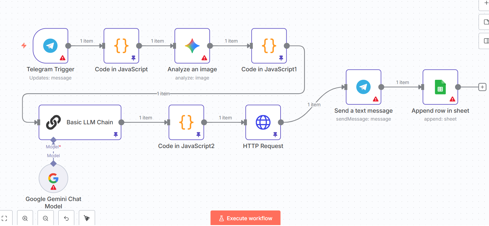

# ai-product-research-automation
AI-powered product research and content discovery workflow built with n8n, Google Sheets, and Telegram.
# AI-Powered Product Research Automation

## Overview

This project is an n8n automation workflow designed to streamline product research and content discovery by collecting product ideas, organizing information in Google Sheets, and sending relevant product images or updates through Telegram.

The workflow demonstrates how AI-powered automation can support product research and simplify repetitive tasks involved in discovering and organizing potential product opportunities.

## Workflow Architecture

The automation workflow includes the following stages:

1. **Scheduled Trigger:** Initiates the workflow automatically on a weekly schedule.
2. **Research and Data Collection:** Retrieves product-related ideas and information using the configured data sources and automation nodes.
3. **Data Organization:** Processes and structures the collected information.
4. **Google Sheets Integration:** Stores research results in a spreadsheet for easier review and tracking.
5. **Telegram Integration:** Sends relevant product images or updates through Telegram.

## Technologies Used

- **n8n** — Workflow automation and orchestration
- **AI tools and APIs** — Supporting automated research tasks, where configured
- **Google Sheets** — Organizing and storing collected information
- **Telegram** — Delivering product images and notifications
- **HTTP APIs** — Connecting external data sources, where applicable

## Key Features

- Scheduled product research
- Automated information collection and organization
- Spreadsheet-based research tracking
- Telegram notifications and image delivery
- Modular workflow that can be adapted to different research needs

## Potential Use Cases

- Product opportunity research
- E-commerce product discovery
- Content planning
- Product trend monitoring
- Marketing research workflows

## Workflow Diagram

## Setup

1. Install or access an n8n instance.
2. Import the exported workflow JSON file.
3. Configure the required API credentials and data sources.
4. Connect your Google Sheets document.
5. Configure the Telegram integration.
6. Test the workflow before enabling its scheduled execution.

## Project Purpose

This project demonstrates practical skills in workflow automation, API integration, data organization, and notification systems. It is part of my portfolio of automation projects focused on reducing repetitive tasks and improving business processes.

## Security

Never publish API keys, access tokens, private credentials, or sensitive information in a public repository.

**Author:** Hadid Mouadh

